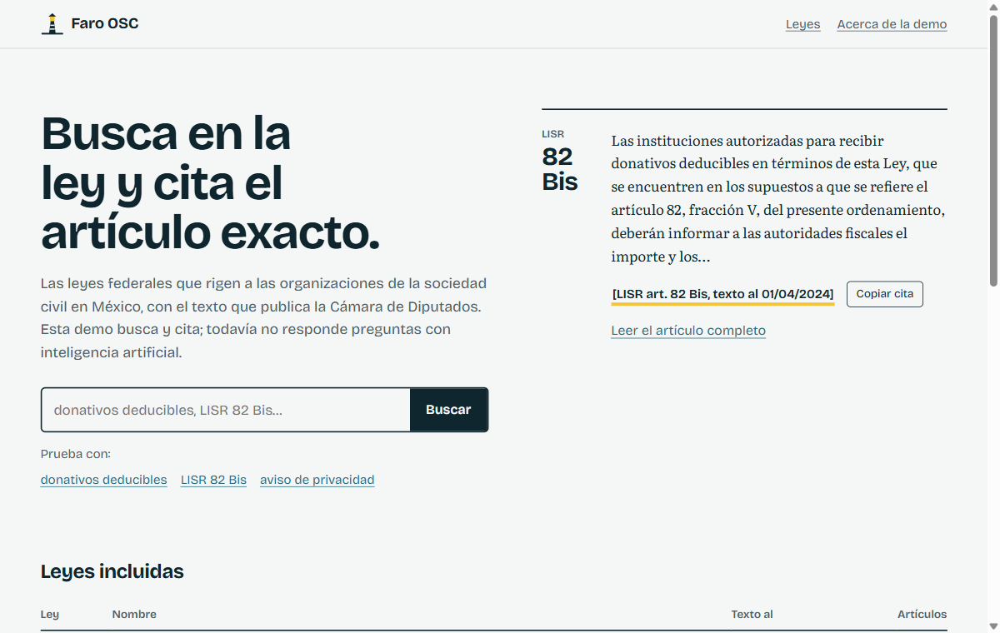
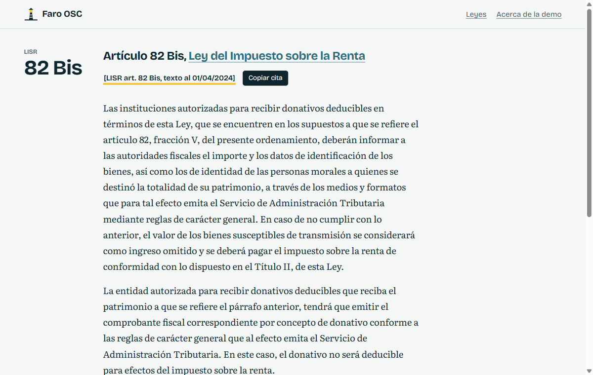
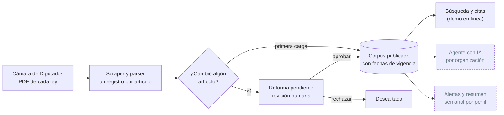

<div align="center">


# Faro OSC

**La ley con el artículo exacto, para organizaciones de la sociedad civil en México.**

[**Ver la demo en línea**](https://faro-osc-demo.vercel.app) &nbsp;·&nbsp; [Cómo funciona](#cómo-funciona) &nbsp;·&nbsp; [Plan de la demo](docs/demo.md) &nbsp;·&nbsp; [Empezar](#empezar)

[](https://faro-osc-demo.vercel.app)
[](LICENSE)
[](#estado)
[](#empezar)
[](https://www.typescriptlang.org)
[](https://nextjs.org)

</div>

<br />

<p align="center">
  <a href="https://faro-osc-demo.vercel.app">
    
  </a>
</p>

## Qué es

Faro OSC es un proyecto abierto para que cada organización de la sociedad civil (OSC) tenga un agente que responda dudas legales **citando el artículo exacto y la versión vigente** de la ley, y que la avise cuando una reforma le afecte. Cada organización tendría el suyo, personalizado con su figura jurídica, sus estatutos y su historial.

La mayoría de las OSC no tiene un abogado de planta y se rige por normas dispersas que cambian cada año: la Ley del ISR, el Código Fiscal, la ley de fomento, la ley antilavado, la de datos personales. Hoy el proyecto resuelve la primera pieza: tener ese corpus **completo, versionado y citable**.

> [!IMPORTANT]
> La demo **no responde preguntas con inteligencia artificial todavía**. Busca en el texto de las leyes y arma la cita. Y nada de lo que muestra es asesoría legal: verifica siempre en el Diario Oficial de la Federación.

## La demo

Un visor del texto oficial de cinco leyes federales (826 artículos), sin cuentas ni claves: **[faro-osc-demo.vercel.app](https://faro-osc-demo.vercel.app)**.

<table>
  <tr>
    <td width="50%" valign="top">
      
    </td>
    <td width="50%" valign="top">

- **Busca** por palabras («donativos deducibles») o por referencia directa («LISR 82 Bis»).
- **Cita** con la ley, el artículo y la fecha del texto, lista para copiar a un oficio o informe.
- **Lee** cada artículo con el texto ya reordenado (los PDF lo traen cortado en renglones) y distingue las notas de reforma del articulado.
- **Verifica** abriendo el PDF oficial de la Cámara de Diputados desde cada ley.

La cita lleva fecha a propósito: la ley cambia, y una cita sin fecha no dice a qué versión se refiere.

</td>
  </tr>
</table>

Leyes incluidas: Ley Federal de Fomento a las Actividades Realizadas por Organizaciones de la Sociedad Civil, Ley del Impuesto sobre la Renta, Código Fiscal de la Federación, Ley Federal para la Prevención e Identificación de Operaciones con Recursos de Procedencia Ilícita y Ley Federal de Protección de Datos Personales en Posesión de los Particulares.

## Estado

| Pieza | Estado | Detalle |
| --- | :---: | --- |
| Corpus de 5 leyes federales | ✅ | Descarga y parseo validados contra los PDF reales de Diputados |
| Versionado por fecha | ✅ | Qué decía un artículo en cada momento; sin versiones traslapadas |
| Cola de revisión de reformas | ✅ | Nada se publica solo; por ahora se aprueba desde la línea de comandos |
| Aislamiento entre organizaciones | ✅ | Seguridad a nivel de fila en Postgres, probada |
| Demo: búsqueda y citas | ✅ | Por palabras clave; no entiende preguntas completas |
| Embeddings (búsqueda por significado) | 🟡 | Código listo y probado con un proveedor simulado; falta probarlo con un modelo real |
| Agente que responde con citas verificadas | ⬜ | Es lo siguiente; requiere decidir quién paga el uso del modelo |
| Perfil por organización y alertas | ⬜ | El esquema existe; falta la aplicación |
| Resumen semanal de cambios y noticias | ⬜ | Diseñado, sin construir |
| Reglamentos, RMF y leyes estatales | ⬜ | Necesitan otras fuentes además de Diputados |

> [!NOTE]
> Lo marcado ✅ en base de datos se probó con [PGlite](https://pglite.dev) (Postgres en WASM), que no incluye pgvector. Aún no se ha corrido contra un Postgres de producción.

## Cómo funciona



Tres ideas sostienen el diseño:

1. **Nada se publica sin revisión.** El texto de Diputados se parsea automáticamente, y un parseo puede fallar. Una diferencia real crea una reforma *pendiente*; la vigencia no cambia hasta que una persona la aprueba. El CLI rechaza parseos dudosos en lugar de publicarlos.
2. **Cada cita lleva su fecha.** Las versiones de un artículo se guardan con su intervalo de vigencia y la base impide que dos versiones publicadas se traslapen.
3. **Los datos de cada organización son suyos.** Todo lo privado queda aislado con seguridad a nivel de fila; la app se conecta con un rol que no puede saltarse esas reglas.

## Estructura

| Carpeta | Qué contiene |
| --- | --- |
| [`apps/web`](apps/web) | La demo: Next.js 16, sin base de datos; lee un snapshot del texto oficial |
| [`packages/corpus`](packages/corpus) | Scraper de Diputados, parser de artículos, diff de versiones, etiquetas por tema |
| [`packages/db`](packages/db) | Esquema Drizzle, migraciones y seguridad por organización (Postgres + pgvector) |
| [`packages/ingesta`](packages/ingesta) | Lleva las leyes a la base, cola de revisión de reformas y cálculo de embeddings |
| [`packages/providers`](packages/providers) | Embeddings con cualquier servicio compatible con la API de OpenAI (Ollama, OpenAI…) |
| `packages/core` · `apps/worker` | Agente y alertas; aún no existen |

## Empezar

Requiere Node 22 o superior y [pnpm](https://pnpm.io) 11.

```bash
pnpm install
pnpm test                         # pruebas de todos los paquetes
pnpm typecheck
pnpm --filter @faro/web dev       # la demo en http://localhost:3000
```

Descargar y revisar las leyes desde la Cámara de Diputados:

```bash
pnpm --filter @faro/corpus build
pnpm --filter @faro/corpus corpus indice     # leyes del MVP y fecha de su última reforma
pnpm --filter @faro/corpus corpus ingest     # descarga, parsea y valida las cinco leyes
```

Regenerar el texto de la demo y publicarla:

```bash
node packages/corpus/dist/cli.js exportar apps/web/data/corpus.json
cd apps/web && vercel --prod
```

Llevar las leyes a una base propia (usa la conexión del dueño de las tablas, no la de la app):

```bash
export DATABASE_URL="postgres://..."
pnpm --filter @faro/ingesta cli ingest        # carga o crea una reforma pendiente
pnpm --filter @faro/ingesta cli pendientes    # reformas esperando revisión
pnpm --filter @faro/ingesta cli aprobar <id>  # publicarla (o `rechazar <id>`)
pnpm --filter @faro/ingesta cli embeber       # embeddings; por defecto Ollama con bge-m3
```

## Cómo ayudar

Lo que más hace falta no es código:

- **Preguntas reales de OSC.** Un conjunto de 50 a 100 preguntas con su respuesta y los artículos correctos, revisado por alguien con formación legal. Será la vara con la que se mida el agente.
- **Revisión jurídica** de las etiquetas por tema y de cómo se leen las reformas.
- **Fuentes**: dónde publican hoy los reglamentos, la Resolución Miscelánea Fiscal y las leyes estatales de asistencia privada.

Si quieres aportar código, abre un issue primero para coordinar.

## Licencia y aviso

Código bajo [AGPL-3.0](LICENSE): si montas un servicio con él, tus cambios también deben ser abiertos. El texto de las leyes es de la Cámara de Diputados; los textos legislativos no están protegidos por derecho de autor (art. 14 de la Ley Federal del Derecho de Autor).

Esta herramienta orienta, no sustituye a una abogada ni a un contador. El texto es el consolidado que publica Diputados y puede no incluir reformas recientes.
